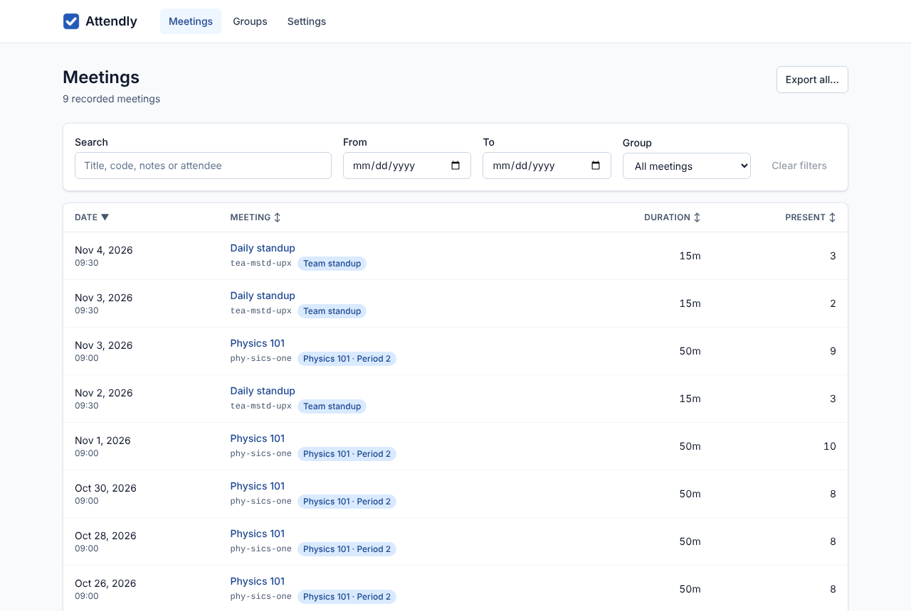
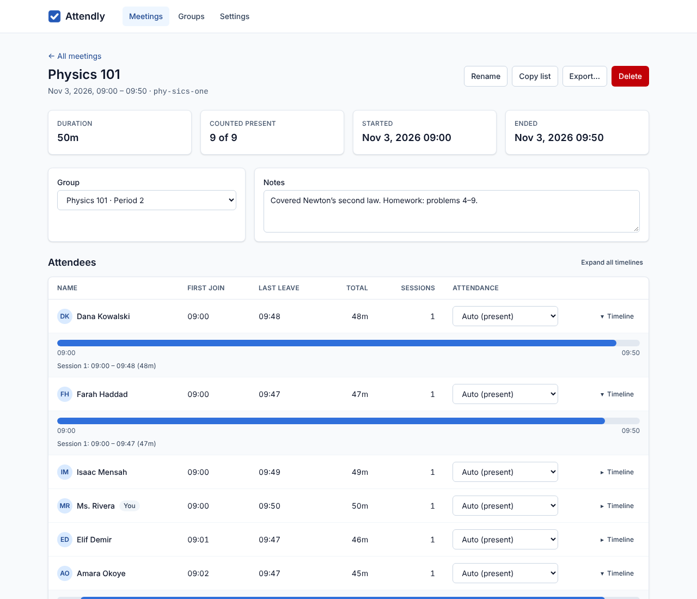
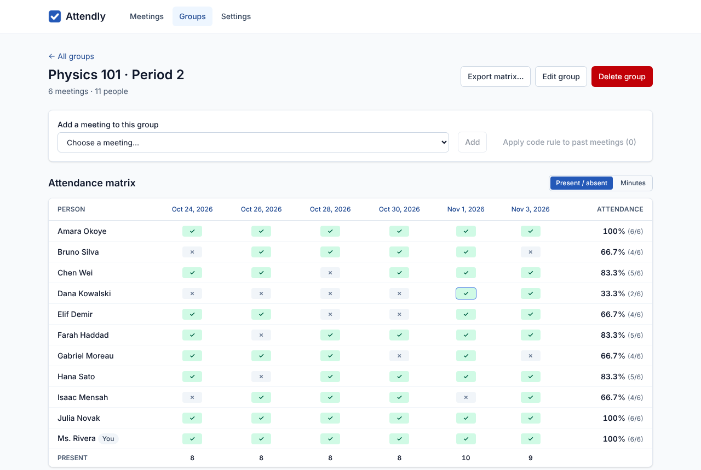
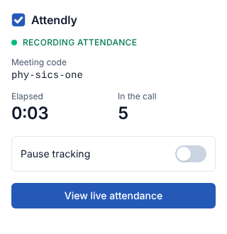

<p align="center">
  
</p>

<h1 align="center">Attendly</h1>

<p align="center"><strong>Automatic, private attendance tracking for Google Meet calls.</strong></p>

<p align="center">
  <a href="https://github.com/ianuragit/attendly/actions/workflows/ci.yml"></a>
  <a href="LICENSE"></a>
  <a href="CHANGELOG.md"></a>
</p>

---

## What it does

Attendly is a Chrome extension that quietly records who attends your Google Meet calls. There
is no button to press: join a call and Attendly notes when each person joins, leaves and
rejoins. Afterwards you can browse past meetings, see a timeline for every participant, follow
attendance across a class or team, and export everything to CSV or Excel.

Everything stays on your computer. Attendly has no servers, no accounts, no analytics and makes
no network requests.

### Features

- **Fully automatic**: starts when you're actually in a call (not on the pre-join screen) and
  stops when you leave, close the tab or navigate away.
- **Join / leave / rejoin timeline** for every participant, with first join, last leave, total
  time and number of sessions. Brief flickers (camera toggles, layout changes) are smoothed out.
- **Handles large calls**: reads video tiles and the People panel, and can open the People panel
  once when the grid can't show everyone.
- **Live popup** with meeting code, elapsed time, live head-count and a pause switch. The
  toolbar badge shows the live count.
- **Meeting history**: search by title, code, notes or attendee; filter by date range and group;
  sort by date, title, duration or attendance.
- **Meeting detail**: rename, add notes, assign a group, mark people present or absent by
  hand, and add attendees who weren't detected (e.g. dial-in by phone).
- **Groups / classes** with an **attendance matrix** (people × meetings) and attendance %
  per person. Meetings can be assigned to a group automatically by meeting code.
- **Export** a meeting, a group matrix or everything to **CSV** or **Excel (.xlsx)**, or copy
  a plain-text list to the clipboard.
- **Backup & restore** all data as JSON.
- **Settings**: minimum time to count as present, hide yourself from lists, poll interval,
  auto-track on/off, 12/24-hour time, light/dark/system theme.
- **Accessible**: keyboard navigable, screen-reader labelled, checked with axe-core (WCAG 2.1 AA)
  in light and dark mode.

## Screenshots

| Meeting history                                            | Meeting detail with timelines                          |
| ---------------------------------------------------------- | ------------------------------------------------------ |
|  |  |

| Group attendance matrix                                 | Popup during a call                  |
| ------------------------------------------------------- | ------------------------------------ |
|  |  |

More: [settings](docs/screenshots/settings.png) ·
[dark mode](docs/screenshots/dashboard-history-dark.png). Screenshots use invented demo data
and are regenerated with `SCREENSHOTS=1 npm run test:e2e -- screenshots`.

## Install

> **⬇️ [Download Attendly (attendly.zip)](https://github.com/ianuragit/attendly/releases/latest/download/attendly.zip)**
> · [All releases](https://github.com/ianuragit/attendly/releases)

### Option 1: Ready-made download (recommended, no tools needed)

Every release is built and tested automatically by GitHub Actions
([Release workflow](.github/workflows/release.yml)).

1. Download **[attendly.zip](https://github.com/ianuragit/attendly/releases/latest/download/attendly.zip)**.
2. Unzip it. You get a folder (e.g. `attendly`) that contains `manifest.json`. Move it somewhere
   permanent, such as your Documents folder: Chrome loads the extension from this folder, so
   don't delete it.
3. Open Chrome and go to `chrome://extensions`.
4. Switch on **Developer mode** (toggle in the top-right corner).
5. Click **Load unpacked** and select the unzipped folder (the one containing `manifest.json`).
6. Click the puzzle-piece icon in the toolbar and **pin** Attendly so you can see its badge.
7. Join a Google Meet call. The badge shows the number of people present. Click the icon for the
   popup, or **Open dashboard** for history, groups, exports and settings.

**Updating:** download the new `attendly.zip`, replace the folder's contents with it, then click
the ↻ reload icon on Attendly's card in `chrome://extensions`. Your meetings and settings are
kept.

**Testing a build that isn't released yet:** open the
[CI runs](https://github.com/ianuragit/attendly/actions/workflows/ci.yml), pick a green run, and
download the **attendly-extension-unpacked** artifact from the run's summary page (you must be
signed in to GitHub). Unzip it and follow steps 3–6 above.

### Option 2: From the Chrome Web Store

_Coming soon_: `https://chromewebstore.google.com/detail/attendly/<extension-id>`

### Option 3: Build from source

1. Clone this repository.
2. Build it (requires Node.js 22.22+):
   ```bash
   npm install && npm run build
   ```
3. Open `chrome://extensions`, switch on **Developer mode**, click **Load unpacked** and select
   the `dist` folder.
4. Pin Attendly from the puzzle-piece (Extensions) menu so the badge is visible.

## How to use

1. **Join a Meet call.** Once you're past the pre-join screen, Attendly starts recording.
   The toolbar badge shows how many people are in the call.
2. **Open the popup** to see the meeting code, elapsed time and live count, or to pause tracking
   (paused time isn't counted for anyone).
3. **Open the dashboard** (popup → _Open dashboard_, or right-click the icon → _Options_) to
   browse meetings. Click a meeting to see attendees and expand anyone's timeline.
4. **Create groups** on the _Groups_ page (e.g. "Physics 101 · Period 2"). Add the class's Meet
   code so future calls are filed automatically, or assign meetings by hand. The group page shows
   the attendance matrix.
5. **Export** from a meeting (_Export…_), a group (_Export matrix…_) or the history page
   (_Export all…_). _Copy list_ puts a plain-text attendee list on the clipboard.
6. **Back up** from _Settings → Backup and restore_.

Tips: "Counted present" uses the minimum time from Settings (default 1 minute); override anyone
with the _Attendance_ dropdown. Rejoining the same meeting code within 5 minutes continues the
same record.

## Development

### Prerequisites

- Node.js 22.22 or newer (see `.nvmrc`), npm
- Chrome or Chromium (end-to-end tests use Playwright's Chromium)

### Scripts

| Command              | What it does                                                                                                                                    |
| -------------------- | ----------------------------------------------------------------------------------------------------------------------------------------------- |
| `npm run dev`        | Vite dev server with hot reload. Load `dist/` unpacked once; pages reload on change                                                             |
| `npm run build`      | Typecheck and build the production extension into `dist/`                                                                                       |
| `npm test`           | Unit tests (Vitest)                                                                                                                             |
| `npm run test:e2e`   | End-to-end tests: real Chromium + built extension + a fake Meet page (run `npm run build` first; first time: `npx playwright install chromium`) |
| `npm run lint`       | ESLint                                                                                                                                          |
| `npm run format`     | Prettier (write); `format:check` to verify                                                                                                      |
| `npm run typecheck`  | `tsc --noEmit`                                                                                                                                  |
| `npm run check:dist` | Verify the built manifest's permissions and that no network APIs ship                                                                           |
| `npm run zip`        | Build, check, and package `attendly-vX.Y.Z.zip` for the Chrome Web Store                                                                        |
| `npm run icons`      | Regenerate the placeholder icons                                                                                                                |

### Project structure

```
src/
  manifest.ts          MV3 manifest (typed, generated at build time)
  background/          service worker: storage, live status, badge, message routing
  content/
    selectors.ts       every Google Meet DOM selector, with fallbacks
    tracker.ts         pure join/leave/rejoin state machine
    controller.ts      observes the page, drives the tracker, saves to the worker
  popup/               toolbar popup
  dashboard/           full-page app: history, meeting detail, groups, settings
  lib/                 shared, mostly pure logic (db, export, xlsx, backup, attendance maths…)
  ui/                  shared React components and hooks
tests/                 Vitest unit tests; tests/e2e Playwright tests; tests/fixtures
docs/                  decisions, Meet DOM notes, store listing, screenshots
scripts/               icon generator, zip packager, dist checker
```

### Debugging

- **Content script:** open DevTools on the Meet tab. Filter the console by `[Attendly]`. Pick
  the "Attendly" context in the console's context dropdown to inspect its state.
- **Service worker:** `chrome://extensions` → Attendly → _Inspect views: service worker_.
  IndexedDB (`attendly` database) is under _Application → Storage_ there.
- **Popup:** right-click the toolbar icon → _Inspect popup_.
- **Without a real call:** `npm run build && npm run test:e2e` drives the real extension against
  a fake Meet page served at `https://meet.google.com/…` via request interception.

## When Google Meet changes its layout

Meet's markup is minified and changes often. Attendly keeps **every selector in
[`src/content/selectors.ts`](src/content/selectors.ts)**, and the tracker refuses to treat an
empty scan as "everyone left", so a breakage loses detail rather than corrupting data. If
attendance stops being recorded:

1. Look for `[Attendly] In a call but no participants were detected…` in the Meet tab's console.
2. In DevTools, inspect a participant tile and the People panel. Find the most **stable** hook:
   - `data-*` attributes (e.g. `data-participant-id`, `data-self-name`) first,
   - then ARIA roles/labels (`role="listitem"`, `aria-label`),
   - then Material icon ligature text (`call_end`, `people`), which doesn't change with language,
   - obfuscated class names / `jsname` values only as a last resort.
3. Add the new hook as an extra strategy in `SELECTORS` (keep the old ones as fallbacks).
4. Update the fixture in `tests/fixtures/meet-dom.ts` if the structure changed, run
   `npm test` and `npm run build && npm run test:e2e`.
5. Record what changed and the date in [`docs/meet-dom-notes.md`](docs/meet-dom-notes.md), and
   run its live-call checklist.

Tips: check both English and another UI language; test a call larger than the grid; test screen
sharing (presentation tiles must not count as people).

## Permissions explained

| Permission                                 | Why                                                                                                                                                                                             |
| ------------------------------------------ | ----------------------------------------------------------------------------------------------------------------------------------------------------------------------------------------------- |
| `storage`                                  | Save your settings (`chrome.storage.sync`) and the live status of an ongoing call (`chrome.storage.session`). Meeting records live in the extension's own IndexedDB, which needs no permission. |
| Host access to `https://meet.google.com/*` | Run the content script that reads participant names from the Meet page. It runs on no other site.                                                                                               |

Attendly does **not** request `tabs`, `activeTab`, `scripting`, `identity`, `cookies`,
`webRequest` or access to any other site. CI fails if the built manifest asks for more
(`npm run check:dist`).

## Privacy

Attendly stores attendance data only on your device and never sends it anywhere: no servers,
no analytics, no third-party code at runtime, and a content security policy that blocks network
connections from its pages. Participant photos are not downloaded or displayed. See
[PRIVACY.md](PRIVACY.md) for the full policy.

Recording attendance may be subject to your organisation's policies or local law. Tell
participants that attendance is being recorded where appropriate.

## Publishing to the Chrome Web Store

1. **Developer account.** Register at the
   [Chrome Web Store Developer Dashboard](https://chrome.google.com/webstore/devconsole)
   (one-time registration fee) and verify your contact email.
2. **Version.** Bump `version` in `package.json` (the manifest reads it) and add a
   `CHANGELOG.md` entry.
3. **Package.** Run `npm run zip`. It builds, checks permissions and network usage, and writes
   `attendly-vX.Y.Z.zip` (contents of `dist/`, manifest at the root).
4. **Create the item.** In the dashboard, click _New item_ and upload the zip.
5. **Store listing.** Use [`docs/store-listing.md`](docs/store-listing.md) for the short and
   long descriptions. Upload the 128×128 icon, at least one 1280×800 (or 640×400) screenshot
   (start from `docs/screenshots/`), and optionally a 440×280 promo tile. Category:
   _Productivity → Education_ or _Workflow & Planning_.
6. **Privacy practices tab.**
   - Single purpose: "Record attendance of Google Meet calls the user joins."
   - Permission justifications: copy them from `docs/store-listing.md`.
   - Remote code: **No**.
   - Data usage: declare _personally identifiable information_ (participant names) and
     _website content_; state that data is not sold, not used for unrelated purposes, not used
     for creditworthiness, and **not transferred off the device**.
   - Privacy policy URL: link to `PRIVACY.md` (e.g. its GitHub URL or a hosted copy).
7. **Distribution.** Choose visibility (public/unlisted/private) and regions.
8. **Submit for review.** Reviews usually take a few days. Narrow host permissions and no
   remote code help. If it's rejected, the email names the policy; fix it and resubmit.
9. **GitHub release:** merging to `main` runs the [Release workflow](.github/workflows/release.yml),
   which tests and builds the extension and publishes release `vX.Y.Z` (tag included) with
   `attendly.zip` and `attendly-vX.Y.Z.zip` attached. You can also run it by hand from the
   _Actions_ tab (_Release → Run workflow_). The Web Store upload can use the same
   `attendly-vX.Y.Z.zip`.

## Roadmap

- Google Sheets export and live CSV sync
- Match meetings to Google Calendar events (titles, invited-but-absent list)
- Optional end-to-end-encrypted cloud sync and accounts
- Zoom and Microsoft Teams support
- Chat log capture (opt-in)
- Scheduled email reports per group
- Localised UI and Meet selectors verified for more languages

## Contributing

Issues and pull requests are welcome.

1. Fork and create a branch.
2. `npm install`, then make your change with tests (`npm test`; for UI or content-script changes
   also `npm run build && npm run test:e2e`).
3. `npm run lint && npm run format:check && npm run typecheck` must pass (CI runs the same).
4. Keep Meet selectors in `src/content/selectors.ts` only, and note judgement calls in
   `docs/decisions.md`.
5. Open a PR describing the change and how you tested it.

Please don't add network calls, analytics or new permissions without discussion; they change
the privacy promise.

## License

[MIT](LICENSE)

---

Attendly is an independent project and is **not affiliated with, endorsed by, or sponsored by
Google**. Google Meet is a trademark of Google LLC and is referred to here only to describe
what the extension works with.
